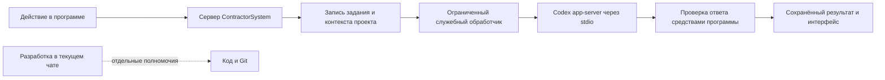

# ContractorSystem: рабочий помощник внутри программы

Дата: 30 октября 2026 года. Объём: **architectural** — меняется способ исполнения AI-задач системы.

Статус: **проект для одобрения владельцем**. Подход выбран; этот документ ещё не одобрен. Реализация, новый рабочий сеанс и модельные проверки по этому проекту не запускались.

## 1. Понятный результат и основание

Владелец работает в ContractorSystem: выбирает проект и действие, нажимает кнопку, получает письмо, ответ или результат проверки в программе. Переносить задания и ответы вручную в чат разработки не нужно.

В текущем чате Codex создаёт и исправляет саму программу. За её интерфейсом работает отдельный прикладной сеанс Codex, которому недоступно изменение кода. Рабочие запросы и история разработки разделены.

Основание: владелец подтвердил кнопку и разделение работ сообщением `01a18bab-cb9d-71a1-a150-d27a331e9eba`, затем выбрал предложенный способ ответом «Да» `01a18bb8-a92c-7372-abc4-885c084c6095` на предъявление `msg_0e557c3f6739130f016ae4464c20f48191ab4f372b93b3d80d`. Снимок: `.superpowers/codex-program-runtime-2026-10-30/approach-evidence.json`. Основание перехода к проектированию проверено локальным workflow gate: `allowed=true, stage=design`.

Цель — рабочая начальная версия для владельца на существующем компьютере. Распределённая платформа, несколько серверов и обслуживание чужих аккаунтов в этот проект не входят. Будущие API и другие модели остаются внутренними заметками и не образуют требований первой версии.

## 2. Подходы и сделанный выбор

| Подход | Последствие | Решение |
|---|---|---|
| Прикладной сеанс через Codex app-server, отдельный от разработки | Кнопки и результаты принадлежат ContractorSystem; требуется служебное подключение и разграничение полномочий | **Выбран владельцем** |
| Передавать рабочие задания в текущий чат разработки | Смешиваются рабочие данные, команды изменения кода и история разработки | Отклонён как противоречащий разделению работ |
| Отдельный внешний модельный API либо другой движок | Другой способ доступа, настройки и расходы; не соответствует выбору текущего этапа | Отложен владельцем до будущего масштабирования |

Рабочий сеанс — отдельный контекст того же продукта Codex. Он не считается копией текущего чата и автоматически не наследует его модель, историю, плагины и полномочия.

## 3. Охват первой версии

Единый рабочий канал Codex должен обслуживать действующие AI-операции программы. Внутренний порядок перевода определяется последующим планом; подключение только писем не закрывает весь этот проект.

| Операция | Текущие точки подключения | Сохраняемый результат |
|---|---|---|
| Создание и правка письма | `/api/generate-letter`, `local-letter-server.ts`, `smart-letter/api/smartLetterApi.ts` | Редактируемый текст, выбранные источники и финансовый снимок |
| Ответы консультанта | `/api/chat`, `AIConsultant.tsx`, `local-consultant-server.ts` | Ответ и история вопроса в программе с привязкой к проекту |
| Радар и предварительная проверка | `/api/scan`, `/api/scan/preview`, `comparison-ai.ts` | Проверяемые выводы, цитаты и история документов |
| Объяснение расценки и предмета работ | `ai-estimator-service.ts`, `pricing-scope-review-server.ts`, `work-change-review-server.ts` | Обоснование и недостающие данные; сохранённые суммы считает программа |
| Дополнение источников и разбор документа | `support-source-enrichment-server.ts`, `/api/documents/process` | Содержательный разбор с подтверждённым покрытием прочитанного материала |

Извлечение текста, локальное распознавание, проверка страниц, поиск сохранённых материалов, арифметика, хранение и печать остаются инструментами ContractorSystem. Их не заменяют свободным ответом модели. Новых скрытых переходов к другим провайдерам нет; в завершённом объёме все указанные AI-ветви обращаются к выбранному Codex.

Ранее принятые 1.3, 1.4, MTM и D1/D2 не открываются заново. Их правила и подтверждённые результаты сохраняются; после изменения исполнителя проверяются затронутые пути. Остаток 1.2, D3 и 1.5 не объявляется завершённым. Неизменённый корпус автоматически не перечитывается и не анализируется повторно.

## 4. Устройство и ответственность

Программа проверяет пользователя, принадлежность проекта, документы, версии, выбранные строки и допустимое действие. Помощник получает подготовленный контекст, выполняет содержательную работу и возвращает структурированный результат. Программа проверяет результат и записывает его штатными средствами.

Один управляемый локальный процесс `codex app-server` связывается с серверной частью через `stdio`. Открытый сетевой порт, отдельный облачный сервер и новый модельный SDK для этого не требуются. Браузер не получает прямой доступ к RPC app-server, его файловым операциям или произвольным thread ID.

Для начальной версии одновременно исполняется одно прикладное модельное задание. Остальные явно ожидают в очереди. Подзадачи не делегируются другим AI; фонового рассуждения при отсутствии пользовательского задания нет. Служебный процесс может ожидать следующую команду, не выполняя модельных запросов.

## 5. Рабочий контекст и граница с разработкой

Рабочий процесс запускается вне исходного репозитория, в отдельной служебной папке ContractorSystem. Он использует собственные прикладные инструкции. Исходный код, Git, терминал, средства правки файлов, глобальные плагины, произвольные MCP-сервисы, внешняя память и дополнительные AI-исполнители не выдаются рабочему помощнику. Все сведения для первой версии подготавливает сервер программы; модельные инструменты для самостоятельных внешних действий не нужны.

В рабочем запуске отключаются shell, делегирование и унаследованные приложения/плагины; применяется политика только чтения. Глобальные настройки Codex и настройки текущего чата не изменяются. Конкретные ключи ограничения сверяются с установленной версией, а фактическое отсутствие запрещённых действий проверяется до допуска. Неизвестные настройки или недоказанное ограничение нельзя выдавать за работающую изоляцию. Сам текст инструкции «не меняй код» не считается защитой.

Тексты документов, прежние ответы и пользовательские поля считаются данными задачи. Команда внутри документа не становится инструкцией менять программу, запускать команды или обращаться к другим проектам. Прикладное задание «написать письмо» не запускает процесс разработки и согласование изменения системы.

Для каждого задания создаётся отдельный рабочий контекст без продолжения чата разработки. Историю консультанта и необходимые сведения передаёт сама программа из соответствующего проекта. Продолжение вопроса не получает сведения другого пользователя или проекта. Внутренний thread ID хранится на сервере и связан с конкретным заданием; предоставленный браузером чужой ID не принимается.

Папка `C:\רייכשטט הנדסה\רייכשטט הנדסה\תבע מזרחית קרית גת` остаётся доступной только для чтения и сверки. Помощник не получает путь для свободного обхода и изменения этой папки.

## 6. Вход и выбор модели

Предлагается использовать уже выполненный вход Codex через ChatGPT. Ключ внешнего платного API не требуется как условие этой реализации. Токены не копируются в код, базу приложения, браузер или журнал.

Рабочие запросы используют доступ и ограничения этой учётной записи; безлимитная или бесплатная работа не обещается. Прикладной профиль, выбранная владельцем модель и режим сохраняются как локальные настройки программы, отдельно от настроек чата разработки. В них нет токенов. При отсутствии первоначального выбора программа предлагает выбрать доступный вариант, а не закрепляет модель по решению помощника.

В существующих настройках программы появляется управление именно рабочим помощником: состояние подключения и ручной выбор доступной модели/режима владельцем. Конкретная модель и режим в этом проекте не предписаны. Список читается у Codex; при недоступности выбора приложение не подменяет его другой моделью или провайдером. Выбор рабочего помощника не меняет модель и режим текущего чата разработки.

При первом использовании настройка рабочего помощника выполняется внутри программы. Если нужен повторный вход, программа показывает штатный вход ChatGPT; это восстановление текущего подключения, а не требование настроить будущую инфраструктуру. Доступность команды и выполненный вход сами по себе не доказывают успешное выполнение модельного запроса.

Локальный прикладной профиль закрепляется за владельцем приложения. Сетевому посетителю или другому пользователю не разрешается использовать аккаунт владельца через произвольный API-запрос. Многопользовательское обслуживание разных аккаунтов — будущий отдельный проект.

## 7. Задание, сохранение и повтор

Для восстановления после обновления страницы используется новая служебная таблица заданий в существующей базе Supabase. Это добавление к схеме, а не изменение настоящих документов, расценок или истории писем. Таблица создаётся только при разрешённой реализации отдельной проверенной миграцией; уже применённая миграция писем повторно не запускается.

Минимальные сведения задания: идентификаторы задания, пользователя и проекта; тип операции; ключ повтора; проверенные входные параметры и версии контекста; состояние и попытка; сохранённый результат; безопасный код ошибки и время изменений. Состояния: `QUEUED`, `RUNNING`, `SUCCEEDED`, `FAILED`, `CANCELLED`, `INTERRUPTED`. Токены и внутренний текст рассуждения не сохраняются.

Для консультанта сохраняется идентификатор разговора и его упорядоченные сообщения, связанные с заданиями нужного проекта. Программа восстанавливает их из своих записей, а не полагается на память чата разработки или долговечность временного модельного сеанса. Завершённые результаты и настоящие пользовательские данные автоматически не удаляются; политика последующей очистки в этот проект не включена.

Ключ запроса уникален в пределах пользователя/проекта. Повтор того же действия возвращает существующее задание и результат, а не создаёт второй модельный вызов. Изменённый текст, стиль, набор документов или явная команда подготовить новый вариант создают новое задание. Повтор уже завершённого результата не вызывает модель. Незавершённое задание после перезапуска помечается прерванным; повтор модели требует явного действия пользователя в программе.

Повтор с тем же ключом и другим отпечатком входов отклоняется как конфликт. Захват очередного задания и завершение выполняются атомарно с ожидаемым состоянием/версией и отметкой исполнителя. После отмены или потери захвата поздний ответ не может перевести задание в успех. Лимит одного исполнителя обеспечивается записью захвата в базе, а не только переменной в памяти Next.js.

Серверная часть владеет изменением состояний. Политики RLS и проверки маршрутов ограничивают чтение и действие принадлежностью проекта. Браузер не может сам записать `SUCCEEDED`, заменить чужой результат или передать произвольный prompt для обхода типа операции. Служебный исполнитель получает ровно необходимые полномочия; секреты базы модели не передаются.

Для таблицы заданий пользовательский доступ ограничен чтением собственных разрешённых записей; прямые INSERT/UPDATE/DELETE из браузера не выдаются. Запись выполняет только сервер через предусмотренный серверный доступ Supabase после проверки настоящего пользователя и принадлежности проекта. На машине обнаружено наличие серверного ключа без чтения его значения в вывод; действительность доступа проверяется при реализации. Все операции с расширенным серверным доступом явно ограничиваются проверенными user/project/job ID. Ключ хранится только в серверной среде и не становится доступным процессу модели. Публичные привилегированные SQL-функции для обхода RLS не добавляются.

Публичный контракт программы предоставляет создать допустимую задачу, получить её состояние/результат и отменить её. Длительный запрос не удерживает единственное HTTP-соединение до конца генерации: интерфейс получает ID и наблюдает состояние. После возврата в раздел он восстанавливает задание по ID и проекту. Статус «выполнено» записывается только после завершения Codex и серверной проверки результата; начало ответа и частичный поток успехом не считаются.

Запуск задания программой и управление его жизненным циклом — прикладные действия владельца. Помощник не записывает бизнес-данные напрямую: результат сохраняется через текущие серверные правила, включая версии и защиту от повторов. Результат письма появляется как редактируемое предложение; существующее действие сохранения DRAFT и отдельная ручная отметка отправки сохраняются. Автоматическая отправка адресату не добавляется.

## 8. Содержание и проверка результата

Стиль, официальный тон и строгость определяет пользователь в программе. Помощник должен писать естественный связный текст на иврите по поставленной задаче. Отдельного модельного судьи и автоматического подбора стиля не требуется.

Сервер проверяет структуру результата, допустимые ссылки и соответствие финансовому снимку. Суммы и НДС формирует существующая арифметика программы. Указанная пользователем дата или число не запрещается только из-за наличия цифр: фактические данные проверяются по входам. Помощник не объявляет оплату согласованной и не создаёт отсутствующие основания.

Цитата связывается с реально сохранённым документом, его версией и исходным текстом. Выбранные источники и суммы не пропадают, если модель не включила ссылку в свой ответ. Непрочитанный фрагмент и непроверенный источник остаются явно отмечены. Краткий контекст одного задания не является заявлением о прочтении всего проекта.

Сохраняются правила поздних согласований, закрытых вопросов, нейтральных записей и пригодности документа. Новый исполнитель не является поводом переписать эти правила или автоматически создать новые карточки. Отпечатки контекста и версии правил позволяют отличить применимый сохранённый результат от устаревшего. Принятые старые результаты не инвалидируются и не пересылаются модели только из-за смены исполнителя.

PDF и документы с изображениями проходят существующее извлечение и проверку покрытия. Для нужного визуального анализа сервер передаёт доступные изображения, если выбранная владельцем модель это поддерживает; отсутствие поддержки показывается для конкретного материала. Непрочитанная страница не становится успешно проверенной. Исходный полный текст не заменяется коротким prompt или пересказом.

## 9. Отказ и продолжение работы

Ожидание, выполнение и готовность видны в том же разделе программы обычными словами. Технические параметры, RPC и будущие требования масштабирования не занимают пользовательский сценарий.

При отказе подключения, недоступности выбранной модели, ограничении аккаунта, истечении времени, неполном ответе или ошибке проверки сохраняются вопрос, пользовательская правка и прежний результат. Показываются понятная причина и конкретное действие: повторить, восстановить вход либо вернуться к выбранной настройке. Программа не отправляет повторный запрос бесконечно и не меняет движок скрытно.

Недоступность помощника относится к конкретному AI-действию. Вход в систему, чтение сохранённых документов, работа с уже готовыми расценками/черновиками и экспорт продолжают работать. Кнопки письма и консультанта больше не зависят от наличия прежней локальной модели. Отмена в программе прерывает связанное задание; поздний ответ отменённого задания не заменяет пользовательский текст.

## 10. Приёмка этого проекта

1. Из программы после входа создаётся настоящее прикладное задание через выбранный Codex; проверен завершённый ответ, а не только `help` или состояние подключения.
2. Письмо появляется и редактируется в программе в выбранном пользователем стиле. Сохранение, повторное открытие, печать/CSV, прежние источники и суммы работают; отметка отправки остаётся отдельной.
3. Вопрос консультанту и продолжение разговора выполняются в программе с историей только нужного проекта. Обновление страницы восстанавливает уже готовый ответ без нового вызова модели.
4. Все AI-ветви из таблицы охвата направлены через единый канал. Неподдержанный конкретный материал не выдаётся за успешно обработанный; полноценные поддержанные примеры проходят свои предметные проверки.
5. Проверены реальное ограничение рабочего процесса, отсутствие shell/правки кода/делегирования/чужих подключений и сохранность контрольных файлов. Проверка одними формулировками инструкций не принимается.
6. Проверены чужой проект/задание, повторный клик, конфликт версий, отмена, перезапуск и неполный ответ. Они не создают лишний результат, чужой доступ или потерю правки.
7. Источники, даты и деньги проверяются действующими правилами; НДС не пересчитывает модель. Прогон синтетических примеров смысла и иврита выполняет текущий Codex без второго модельного судьи.
8. Не запускаются повторный разбор неизменённого корпуса и обработка приостановленных материалов. Настоящие данные, защищённая папка и прежние принятые результаты сохранены.
9. Выполнены профильные автоматические проверки, TypeScript, lint, production-сборка и проверка установленного приложения после входа. Отдельно проверено восстановление после недоступности помощника.
10. Остаток и доказательства записаны по фактическим результатам. Установка в рабочий адрес производится только после проверенного сквозного сценария; до этого проверенный выпуск A остаётся доступен.

Условия прежней задачи8 о пригодной локальной генерации не переписываются и не объявляются выполненными. CH2 вводит отдельные условия приёмки рабочего канала Codex. Требование прежнего прогона именно на Ollama не переносится как обязательный вызов другого движка в этот проект; предметные проверки сохраняются и запускаются через выбранного исполнителя. Эта корректировка входит в предъявленный проект для явного одобрения владельцем.

## 11. Что остаётся исполнителю и что требует нового решения

Исполнитель выбирает имена внутренних модулей и служебной таблицы, формат адаптеров, ограниченные тайм-ауты и способ наблюдения состояния в рамках описанных гарантий. До реализации сверяются поддержанные поля фактической версии app-server. Новые зависимости не устанавливаются автоматически; используется существующая среда и текущие библиотеки.

Отдельного решения потребуют смена движка, фиксирование конкретной модели без ручного выбора владельца, доступ рабочего помощника к изменению кода, внешняя отправка писем, массовый повторный разбор настоящих данных, несколько пользователей/аккаунтов и перенос на отдельный сервер. Эти изменения не входят в текущий проект.

После одобрения этой редакции следующий шаг — `superpowers:writing-plans`, письменный план и проверка его предъявленной редакции. Одобрение подхода не считается одобрением этого документа или ещё не созданного плана.

## 12. Подтверждённая основа и самопроверка

На момент проектирования установлена `codex-cli 0.162.1`; `codex login status` вернул `Logged in using ChatGPT`. Экспорт схемы этой версии подтверждает поля `ThreadStartParams` для прикладных инструкций, контекста, временного сеанса и настроек; `TurnStartParams` содержит `outputSchema`. Экспорт схемы и список возможностей не запускают рабочую модель. Фактический inference-доступ этой интеграцией ещё не проверен.

Источники: [Codex app-server](https://learn.chatgpt.com/docs/app-server), [встраивание Codex в приложения](https://developers.openai.com/blog/codex-as-a-platform), [настройки Codex](https://learn.chatgpt.com/docs/config-file/config-reference), [разграничение данных Supabase](https://supabase.com/docs/guides/database/postgres/row-level-security). Схемы установленной версии: `.superpowers/codex-program-runtime-2026-10-30/protocol`. Прямое чтение кода подтвердило перечисленные точки подключения; Graphify-граф отсутствует, новые AI-индексаторы не запускались.

Самопроверка автора выполнена в текущем чате без дополнительных AI-проверяющих. В ходе проверки уточнены: общий охват AI-ветвей; хранение результата после обновления страницы; ручной выбор рабочего профиля; отличие ограничений процесса от одной текстовой инструкции; отсутствие автоматической приёмки старого R04. Оставшихся существенных вопросов для составления плана в описанных границах нет. Эта самопроверка не называется независимым ревью и не заменяет одобрение владельцем или проверку реальной реализации.
